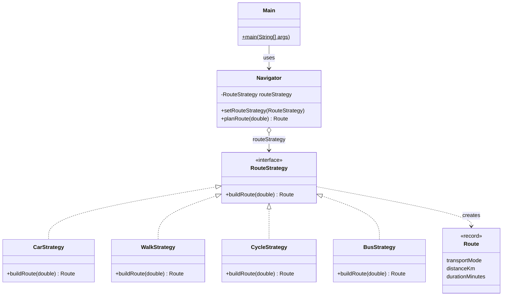

# Assignment #5 - Strategy Pattern

**Course:** ShP-2216 - Software Design Patterns  
**Student:** Yershadi Nurassyl  
**Group:** SE-2523  
**Topic:** Navigation / Route Planning (Option A)

## 1. Introduction

The chosen domain is **navigation / route planning** (Option A). The family of interchangeable algorithms is the way a route is calculated for a given transport mode: by car, on foot, by bicycle and by bus. Every mode converts the straight-line distance between two points into a real route distance and a travel time, but each does it differently (different distance factor, different average speed, a waiting time for the bus).

The **Navigator** is the Context. It holds a reference to a **RouteStrategy** and delegates route calculation to it. **CarStrategy**, **WalkStrategy**, **CycleStrategy** and **BusStrategy** are the Concrete Strategies. **Main** is the Client: it creates the strategy and switches it at runtime with *setRouteStrategy*.

Output of the demonstration (straight-line distance 8 km):

```
Car route: 10.4 km, 12 min
Walking route: 8.8 km, 106 min
Cycling route: 9.6 km, 38 min
Bus route: 9.6 km, 33 min
```

## 2. UML class diagram



Core classes:

```java
public interface RouteStrategy {

    Route buildRoute(double straightLineDistanceKm);
}

public class Navigator {

    private RouteStrategy routeStrategy;

    public Navigator(RouteStrategy routeStrategy) {
        setRouteStrategy(routeStrategy);
    }

    public void setRouteStrategy(RouteStrategy routeStrategy) {
        this.routeStrategy = Objects.requireNonNull(
                routeStrategy, "routeStrategy must not be null");
    }

    public Route planRoute(double straightLineDistanceKm) {
        return routeStrategy.buildRoute(straightLineDistanceKm);
    }
}

public class CarStrategy implements RouteStrategy {

    private static final double ROAD_DISTANCE_FACTOR = 1.3;
    private static final double AVERAGE_SPEED_KMH = 50.0;

    @Override
    public Route buildRoute(double straightLineDistanceKm) {
        double distanceKm = straightLineDistanceKm * ROAD_DISTANCE_FACTOR;
        double durationMinutes = distanceKm / AVERAGE_SPEED_KMH * 60.0;
        return new Route("Car", distanceKm, durationMinutes);
    }
}
```

Client (runtime switching):

```java
Navigator navigator = new Navigator(new CarStrategy());
System.out.println(navigator.planRoute(STRAIGHT_LINE_DISTANCE_KM));

navigator.setRouteStrategy(new WalkStrategy());
System.out.println(navigator.planRoute(STRAIGHT_LINE_DISTANCE_KM));

navigator.setRouteStrategy(new CycleStrategy());
System.out.println(navigator.planRoute(STRAIGHT_LINE_DISTANCE_KM));

navigator.setRouteStrategy(new BusStrategy());
System.out.println(navigator.planRoute(STRAIGHT_LINE_DISTANCE_KM));
```

## 3. Clean Code

Six Clean Code principles (Clean Code, Ch. 10) are applied. Each one is shown with a before / after excerpt. The Before excerpts are illustrative anti-examples and are not part of the repository.

### 3.1 Elimination of conditional logic in favor of polymorphism

The choice of algorithm is expressed by the object the Navigator holds, not by branching. Navigator contains no if or switch on the transport type, and adding a mode never changes its body.

**Before:**

```java
public Route planRoute(String mode, double km) {
    switch (mode) {
        case "car":   return new Route("Car", km * 1.3, km * 1.3 / 50 * 60);
        case "walk":  return new Route("Walking", km * 1.1, km * 1.1 / 5 * 60);
        case "cycle": return new Route("Cycling", km * 1.2, km * 1.2 / 15 * 60);
        default: throw new IllegalArgumentException(mode);
    }
}
```

**After:**

```java
public Route planRoute(double straightLineDistanceKm) {
    return routeStrategy.buildRoute(straightLineDistanceKm);
}
```

### 3.2 Meaningful, intention-revealing names

Class names state the transport mode (CarStrategy, WalkStrategy, CycleStrategy, BusStrategy). The method name buildRoute says what it does, and every number is a named constant whose name carries its unit.

**Before:**

```java
public Route calc(double d) {
    double x = d * 1.3;
    return new Route("Car", x, x / 50 * 60);
}
```

**After:**

```java
private static final double ROAD_DISTANCE_FACTOR = 1.3;
private static final double AVERAGE_SPEED_KMH = 50.0;

public Route buildRoute(double straightLineDistanceKm) { ... }
```

### 3.3 Single Responsibility Principle

Each strategy has exactly one reason to change: its own algorithm. Route only carries the result, Navigator only delegates, and Main only wires objects together and prints.

**Before:**

```java
public class Navigator {
    public Route planCar(double km)   { ... }
    public Route planWalk(double km)  { ... }
    public Route planCycle(double km) { ... }
}
```

**After:**

```java
public class WalkStrategy implements RouteStrategy {
    @Override
    public Route buildRoute(double straightLineDistanceKm) { ... }
}
```

### 3.4 Context is algorithm-agnostic (Dependency Inversion)

Navigator imports only the RouteStrategy interface. It has no knowledge of the speed, distance factor or any internals of a concrete strategy, so high-level code depends on an abstraction, not on details.

**Before:**

```java
import kz.aitu.navigation.strategy.CarStrategy;
import kz.aitu.navigation.strategy.WalkStrategy;

private CarStrategy car = new CarStrategy();
```

**After:**

```java
import kz.aitu.navigation.strategy.RouteStrategy;

private RouteStrategy routeStrategy;
```

### 3.5 Easy extensibility (Open/Closed Principle)

BusStrategy was added in a separate commit (10f4ffe) as one new file. Navigator, RouteStrategy, CarStrategy, WalkStrategy and CycleStrategy were not touched. The only change is in the client, which chooses which strategy to use.

**Before:**

```java
case "bus": return new Route("Bus", km * 1.2, km * 1.2 / 25 * 60 + 10);
```

**After:**

```java
public class BusStrategy implements RouteStrategy {
    @Override
    public Route buildRoute(double straightLineDistanceKm) { ... }
}

navigator.setRouteStrategy(new BusStrategy());
```

### 3.6 Fail fast, no magic numbers, self-documenting code

A null strategy is rejected immediately in the setter with Objects.requireNonNull, so Navigator can never be left in an invalid state. Numeric literals are named constants, methods are short, and the code is clear enough to need no comments.

**Before:**

```java
public void setRouteStrategy(RouteStrategy s) {
    this.routeStrategy = s;
}
double minutes = km / 50 * 60;
```

**After:**

```java
public void setRouteStrategy(RouteStrategy routeStrategy) {
    this.routeStrategy = Objects.requireNonNull(
            routeStrategy, "routeStrategy must not be null");
}
double durationMinutes = distanceKm / AVERAGE_SPEED_KMH * 60.0;
```

## 4. Strategy vs. State

Strategy fits this problem better than State because the transport mode is a choice made from outside by the client or the user, and the algorithms are independent alternatives that do not know about each other. Navigator does not change its own behavior by itself: nothing inside Navigator or inside a strategy decides that a car route should become a walking route. In State the situation is opposite. The context has an internal lifecycle, the state objects know each other, and each state decides the next state, for example Idle to Navigating to Arrived. Both patterns share the same structure (a context delegating to an interface), but the intent differs: Strategy replaces one algorithm with another on request and has no transitions, while State models changes of behavior caused by changes of the object's own state, with transitions between states.

## 5. Conclusion

Applying Strategy replaced a chain of conditionals with one interface and four small classes. The cost is more files: five types (one interface and four strategies) instead of one class with a switch, plus a little indirection when reading the code. The gain is larger. Navigator is closed for modification, every algorithm can be understood, changed and tested in isolation, the strategy can be swapped at runtime, and a new transport mode is added by writing one new class. For a family of only two trivial variants the extra classes might be too much, but for algorithms that are expected to grow in number the flexibility clearly outweighs the number of classes added.

## 6. GitHub repository

https://github.com/n4120236-hue/Assignment-5-SDP.-.git

## References

- Freeman, E., Robson, E. (2021). Head First Design Patterns (2nd ed.), Ch. 1 (Strategy).
- Martin, R. C. (2008). Clean Code, Ch. 10 (Classes).
- Lecture 7 slides, ShP-2216 (Strategy pattern and comparison with State).
- refactoring.guru/design-patterns/strategy
